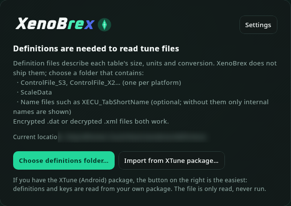
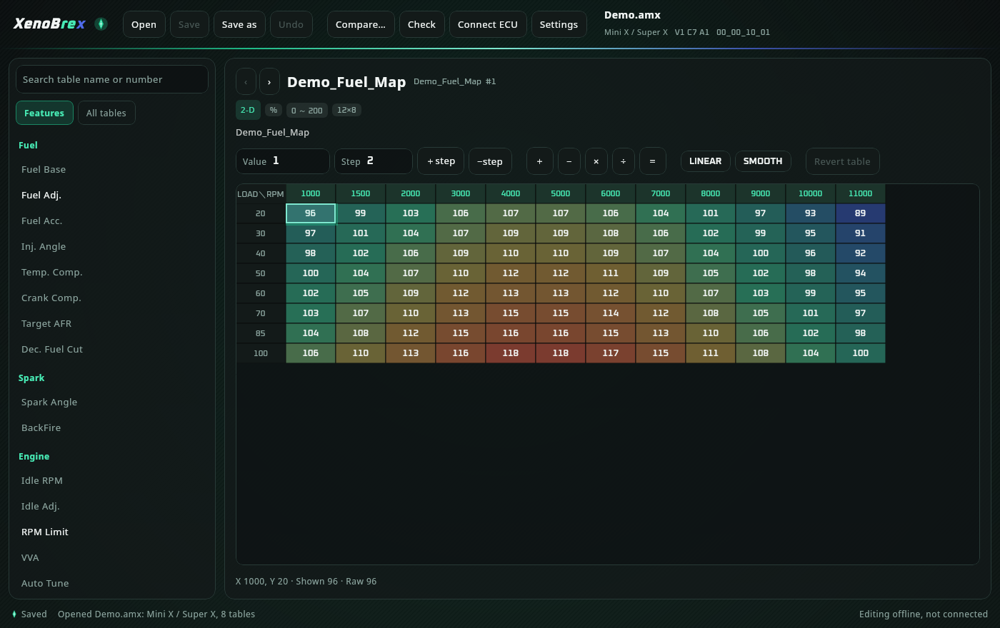
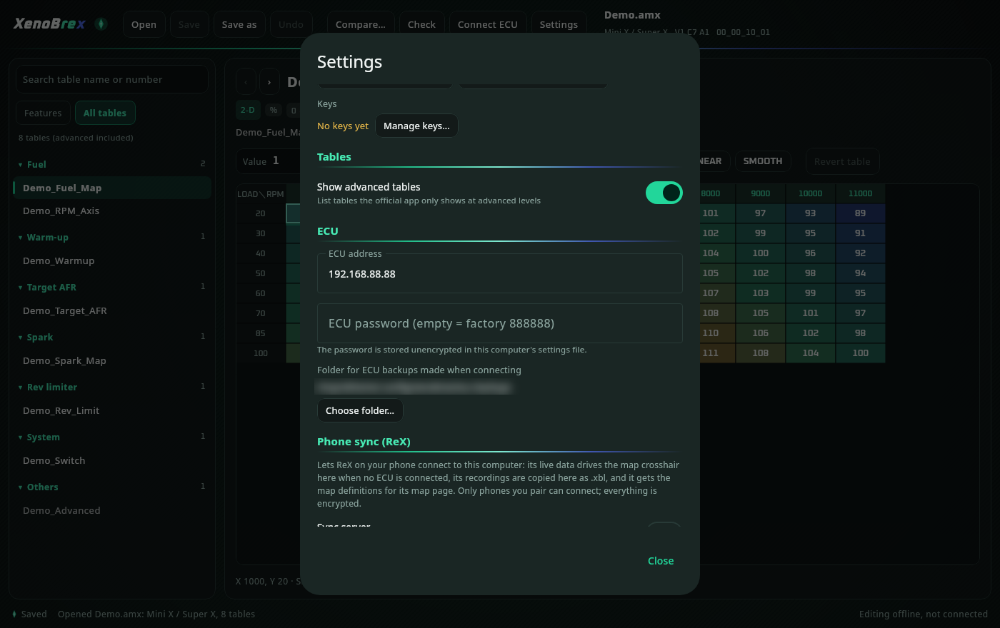

# Getting started with XenoBrex

[繁體中文](getting-started.md)

This guide takes you from installing XenoBrex to opening your first tune file. You don't need the bike for any of it.

## 1. Install

Download the installer for your system from [Releases](https://github.com/xeno-hf/XenoBrex/releases/latest):

| System | File | First launch |
|---|---|---|
| Windows | `.msi` | The installer is not signed. When "Windows protected your PC" appears, click "More info" → "Run anyway" |
| macOS (Apple Silicon) | `.dmg` | If it is blocked the first time, go to System Settings → Privacy & Security and click "Open Anyway" |
| Linux | `.tar.gz` | Unpack it and run `install.sh` |

## 2. Import the definitions and keys

XenoBrex does not include aRacer's definition files or keys, so the first launch shows this screen:

The easiest way is to import them from the **XTune (Android) installer**:

1. Download the XTune `.xapk` on your computer, for example [aRacer X Tune on APKPure](https://apkpure.com/aracer-x-tune/com.aracer.skycal/download) (click "Download XAPK", about 80 MB; you don't need to install it).
   - Or export `.apks` from the XTune installed on your own phone with a tool such as SAI (Split APKs Installer).
   - `base.apk` alone is not enough; use the complete `.xapk` / `.apks`.
2. Click "Import from XTune package…" and choose that file.
3. The definitions and keys are set up automatically. XenoBrex only reads the file and never runs anything in it.

One XTune installer contains the definitions for every model (Mini X, Super X, Mini XX, Super XX…), so you only need to import it once.

If you already have a definitions folder, you can click "Choose definitions folder…" instead, then paste your own keys in Settings → Manage keys….

## 3. Open a tune file

Click "Open" in the toolbar and choose your tune file:

| ECU | Extension |
|---|---|
| Mini X | `.amx` |
| Super X | `.asx` |
| Mini XX | `.amx2` |
| Super XX | `.asx2` |

The screenshots use the demo file `sample/Demo.amx` from this repository, not data from any ECU.

- **Left**: the table list. "Features" groups tables by purpose, "All tables" lists everything by the definition's groups. Search by table name or number at the top.
- **Right**: the table. Click a cell to select it, or drag to select an area, then use the tools above:
  - "Value" with + − × ÷ =: add, subtract, multiply, divide, or set to the value
  - "Step" with +step / −step: change by one step each press
  - LINEAR: select 3 or more cells in one row or column; keeps both ends and fills evenly in between
  - SMOOTH: select 3 or more cells to smooth them
  - "Revert table" goes back to the file's contents; "Undo" in the toolbar steps back one edit at a time
- Click "Save" when you are done. The first time you overwrite the original, a `.bak` copy is kept. "Save as" writes to another file.

## 4. Show advanced tables

XTune only shows some of the tables. Turn on Settings → Tables → "Show advanced tables" to also list the tables the official app only shows at advanced levels:

For example, on the Mini X the base ignition map `SA Base` and the VM base fuel map `D3Cyl1_VM` are always listed, while the RPM axes used by the fuel and ignition maps (such as `D2_Scale_RPM20C`, 800 rpm per cell) are advanced tables and only appear with this option on.

Please note:
- This option only lists **tables the definition already has for your model**. XenoBrex does not unlock paid functions or tables that aRacer has not enabled for your model.
- An axis is shared by several tables. Changing it changes every table that uses it, so think it through and back up first.

## Next

- [Connect to the ECU and tune live](live-tuning.en.md)
- [FAQ](faq.en.md)
