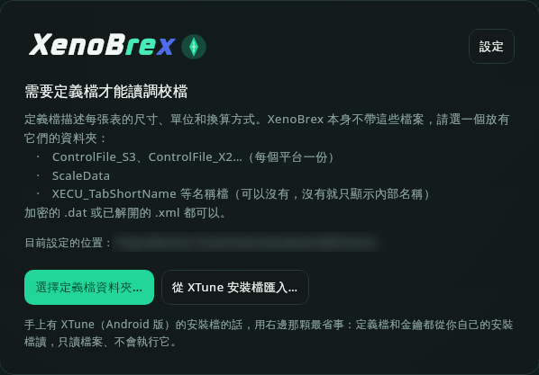
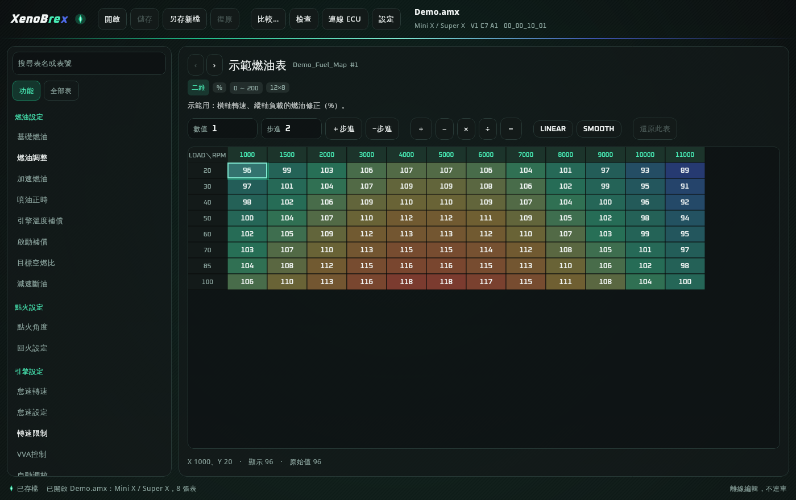
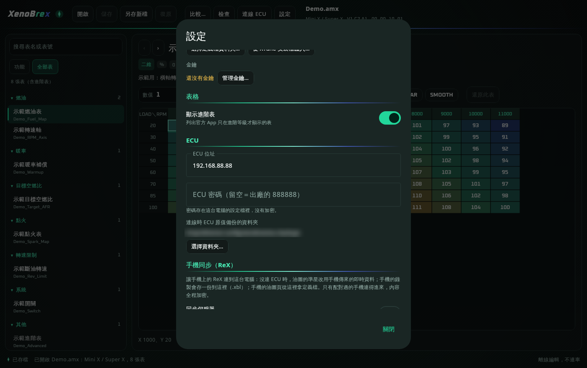

# 第一次使用 XenoBrex

[English](getting-started.en.md)

這篇帶你從安裝到打開第一個調校檔。不需要連車，在電腦上就能完成。

## 1. 安裝

到 [Releases](https://github.com/xeno-hf/XenoBrex/releases/latest) 下載對應系統的安裝檔：

| 系統 | 檔案 | 第一次開啟 |
|---|---|---|
| Windows | `.msi` | 安裝檔沒有簽章，Windows 跳出「Windows 已保護您的電腦」時，按「其他資訊」→「仍要執行」 |
| macOS（Apple Silicon） | `.dmg` | 第一次被擋下時，到「系統設定 → 隱私權與安全性」按「強制打開」 |
| Linux | `.tar.gz` | 解壓後執行 `install.sh` |

## 2. 匯入定義檔和金鑰

XenoBrex 不附 aRacer 的定義檔和金鑰，第一次開啟會看到這個畫面：

最簡單的方式是用 **XTune（Android 版）的安裝檔** 匯入：

1. 在電腦上下載 XTune 的 `.xapk`，例如 [APKPure 的 aRacer X Tune](https://apkpure.com/aracer-x-tune/com.aracer.skycal/download)（按「Download XAPK」，約 80 MB，不用安裝）。
   - 或用 SAI（Split APKs Installer）之類的工具，從自己手機上已安裝的 XTune 匯出 `.apks`。
   - 只有 `base.apk` 不夠，要完整的 `.xapk`／`.apks`。
2. 按「從 XTune 安裝檔匯入…」，選剛剛的檔案。
3. 完成後定義檔和金鑰會自動設定好。XenoBrex 只讀這個檔案，不會執行裡面的程式。

一份 XTune 安裝檔就包含所有型號（Mini X、Super X、Mini XX、Super XX…）的定義檔，只要匯入一次。

如果你手上已經有定義檔資料夾，也可以按「選擇定義檔資料夾…」，再到「設定 → 管理金鑰…」貼上自己的金鑰。

## 3. 開啟調校檔

按工具列的「開啟」，選你的調校檔：

| ECU | 副檔名 |
|---|---|
| Mini X | `.amx` |
| Super X | `.asx` |
| Mini XX | `.amx2` |
| Super XX | `.asx2` |

截圖用的是 repo 內建的示範檔 `sample/Demo.amx`，不是任何 ECU 的資料。

- **左邊**是表清單。「功能」照用途分類，「全部表」照定義檔的群組列出全部；上方可以用表名或表號搜尋。
- **右邊**是表格。點格子選取，可以拖曳選一片，再用上方的工具改值：
  - 「數值」＋「＋ － × ÷ ＝」：加、減、乘、除、直接設成這個值
  - 「步進」＋「＋步進／－步進」：每按一次加減一個步進
  - LINEAR：選同一列或同一欄 3 格以上，保留兩端、中間平均補齊
  - SMOOTH：選 3 格以上，讓數值平滑
  - 「還原此表」：回到檔案原本的內容；工具列的「復原」可以一步一步退回
- 改完按「儲存」。第一次覆蓋原檔時會自動留一份 `.bak`。也可以用「另存新檔」。

## 4. 顯示進階表

XTune 只會顯示一部分的表。到「設定 → 表格」打開「顯示進階表」，就能看到官方 App 只在進階等級才顯示的表：

例如 Mini X 的基礎點火表 `SA Base`、VM 基礎油表 `D3Cyl1_VM` 平常就看得到；油圖和點火表用的轉速軸（例如 800 轉一格的 `D2_Scale_RPM20C`）屬於進階表，開了這個選項才會列出來。

注意：
- 這個選項只會列出**定義檔裡這個型號本來就有的表**。aRacer 沒開放給這個型號的付費功能和表，XenoBrex 不會解鎖。
- 軸表是好幾張表共用的，改了軸，所有用這條軸的表都會跟著變，改之前請先想清楚、先備份。

## 下一步

- [連線 ECU 即時調校](live-tuning.md)
- [常見問題](faq.md)
