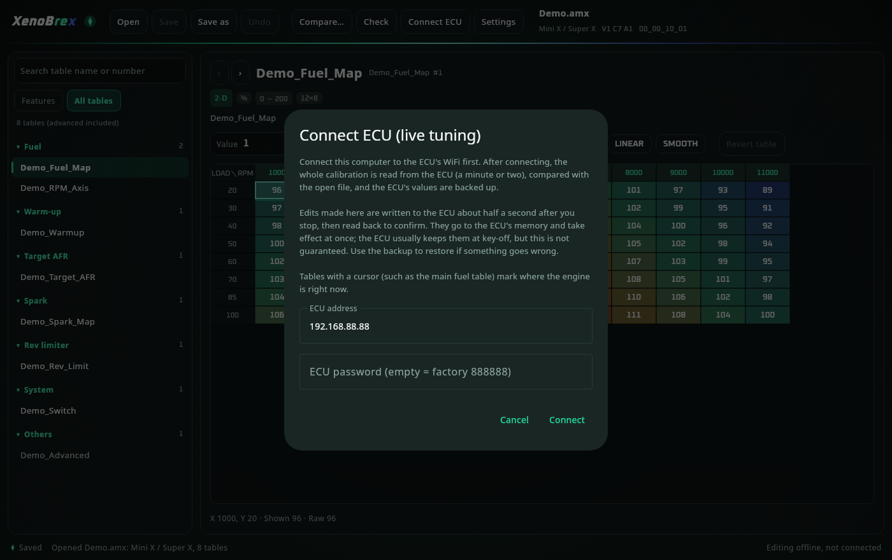

# Connect to the ECU and tune live

[繁體中文](live-tuning.md)

> **Read this first**: live writes, writing the whole tune to the ECU and restoring from a backup are **not yet fully verified on a real bike**. Changing tables changes how the engine runs. Tune somewhere safe with the bike stopped; you are responsible for your settings. Before your first use, make sure you know where the backup is and how to restore it.

## Before connecting

1. Open **the tune file for this bike's ECU** in XenoBrex (same model and version). "Connect ECU" stays grey until a file is open.
   - If the versions differ you will see "The ECU's version differs from this tune file; live tuning is not possible". Open the right file instead.
2. Close XTune on your phone (or turn off the phone's Wi-Fi). The ECU accepts only one connection at a time.
3. Turn the key on and connect your computer to the ECU's Wi-Fi, the same network your phone joins for XTune.

## Connect

Click "Connect ECU" in the toolbar:

- **ECU address**: `192.168.88.88` by default; usually you don't need to change it.
- **ECU password**: leave it empty if you never changed it (factory default `888888`).

After you click "Connect", XenoBrex:

1. Reads the whole calibration from the ECU (a minute or two).
2. Saves a **backup of the original values** and checks that it reads back.
3. Compares it with the open file.

### If "The ECU's values differ from the file" appears

The ECU's values are not the same as the file you opened. Both sides must match before you can tune live:

- **Use the ECU's values**: the editor switches to what is on the ECU, and the ECU is not changed. Choose this on your first connection, or whenever you are not sure which side is newer.
- **Write the file to the ECU**: writes the tables that differ from the file to the ECU.

## Live tuning

Once connected, edit a table; about half a second after you stop, the edit is written to the ECU and read back to confirm. It goes to the ECU's memory and takes effect at once; the ECU usually keeps it at key-off, but this is not guaranteed.

Tables with a cursor (such as the main fuel table) mark where the engine is right now.

While connected, the toolbar has two more buttons:

- **Write to ECU**: writes the whole current content to the ECU's flash so it stays after key-off. Don't turn the key off or start the engine while it is writing.
- **Restore…**: writes back the original backup made when you connected, row by row, and reads each row back.

When you are done, click "Disconnect". Changes not yet sent are sent first.

## Where the backups are

Every connection saves a backup of the original values:

| System | Location |
|---|---|
| Windows | `%APPDATA%\XenoBrex\ecu-backups` |
| macOS | `~/Library/Application Support/XenoBrex/ecu-backups` |
| Linux | `~/.config/xenobrex/ecu-backups` |

You can change the folder in Settings → ECU.

## If "ECU recovery required" appears

The ECU stopped answering during a write, so XenoBrex stopped writing and disconnected. The message tells you where the backup is. Then:

1. **Don't ride the bike yet.**
2. Keep the backup file named in the message.
3. Connect again (it only reads first). If "The ECU's values differ from the file" appears, don't press either button yet; take a screenshot.
4. Report it in [Discussions](https://github.com/xeno-hf/XenoBrex/discussions) or as an [Issue](https://github.com/xeno-hf/XenoBrex/issues), with the screenshot and the log file:
   - Windows: `%APPDATA%\XenoBrex\logs\xenobrex.log`
   - macOS: `~/Library/Application Support/XenoBrex/logs/xenobrex.log`
   - Linux: `~/.config/xenobrex/logs/xenobrex.log`
5. If needed, you can also write back a tune you saved before with XTune, the usual way.

## See also

- [Getting started](getting-started.en.md)
- [FAQ](faq.en.md)
