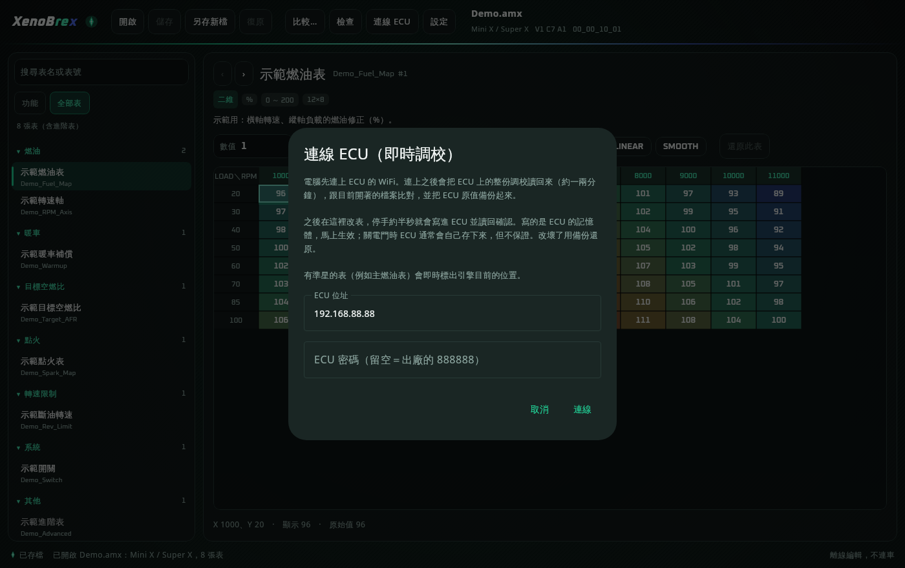

# 連線 ECU 即時調校

[English](live-tuning.en.md)

> **請先讀**：即時寫入、整份存進 ECU、從備份還原，這幾條實車寫入路徑**都還沒在實車上完整驗證**。改表會直接改變引擎的行為，請在安全的地方、車子停著的時候調，改過的設定自己負責。第一次用之前，先確認你知道備份放在哪裡、怎麼還原。

## 連線前

1. 先在 XenoBrex 開啟**這台車 ECU 用的調校檔**（型號、版本要一樣）。沒開檔的話「連線 ECU」是灰的。
   - 版本不同時會顯示「ECU 的版本跟這份調校檔不同，不能即時調校」，請改開對的檔案。
2. 關掉手機上的 XTune（或把手機 Wi-Fi 關掉）。ECU 一次只接受一個連線。
3. 鑰匙轉到 ON，電腦連上 ECU 的 Wi-Fi，也就是手機開 XTune 時連的那一個。

## 連線

按工具列的「連線 ECU」：

- **ECU 位址**：預設 `192.168.88.88`，一般不用改。
- **ECU 密碼**：沒改過的話留空，就是出廠的 `888888`。

按「連線」之後，XenoBrex 會：

1. 把 ECU 上的整份校正讀回來（約一兩分鐘）。
2. 存一份**原值備份**，並確認備份可以讀回。
3. 跟你開著的檔案比對。

### 如果跳出「ECU 上的值跟檔案不同」

代表 ECU 裡的值跟你開的檔案不一樣，要先讓兩邊一致才能即時調校：

- **用 ECU 的值**：編輯器改成 ECU 目前的內容，ECU 不會被改動。第一次連線、不確定哪邊比較新的話，選這個。
- **把檔案寫進 ECU**：把檔案裡不同的表寫進 ECU。

## 即時調校

連上之後，在表格上改值，停手約半秒就會寫進 ECU 並讀回確認。寫進去的是 ECU 的記憶體，馬上生效；關電門時 ECU 通常會自己存下來，但不保證。

有準星的表（例如主燃油表）會即時標出引擎目前在哪一格。

連線中工具列會多出兩個按鈕：

- **存進 ECU**：把目前的整份內容寫進 ECU 的快閃記憶體，關電門後也會保留。寫入期間不要關電門、不要發動。
- **還原…**：用這次連線時存的原值備份，逐列寫回並讀回確認。

調完按「中斷連線」，還沒送出的修改會先送出再斷線。

## 備份在哪裡

每次連線都會存一份原值備份：

| 系統 | 位置 |
|---|---|
| Windows | `%APPDATA%\XenoBrex\ecu-backups` |
| macOS | `~/Library/Application Support/XenoBrex/ecu-backups` |
| Linux | `~/.config/xenobrex/ecu-backups` |

位置可以在「設定 → ECU」改。

## 如果出現「ECU 需要復原」

寫入時 ECU 沒有回應，XenoBrex 會停止寫入、斷線，並顯示這個訊息，訊息裡會寫出備份檔的位置。這時候：

1. **先不要騎車。**
2. 保留訊息裡寫的備份檔。
3. 重新連線（只會先讀，不會寫）。如果跳出「ECU 上的值跟檔案不同」，先不要按任何按鈕，截圖。
4. 到 [Discussions](https://github.com/xeno-hf/XenoBrex/discussions) 或 [Issue](https://github.com/xeno-hf/XenoBrex/issues) 回報，附上截圖和紀錄檔：
   - Windows：`%APPDATA%\XenoBrex\logs\xenobrex.log`
   - macOS：`~/Library/Application Support/XenoBrex/logs/xenobrex.log`
   - Linux：`~/.config/xenobrex/logs/xenobrex.log`
5. 需要的話，也可以用 XTune 照原本的方式，寫回你以前存的調校檔。

## 相關

- [第一次使用](getting-started.md)
- [常見問題](faq.md)
